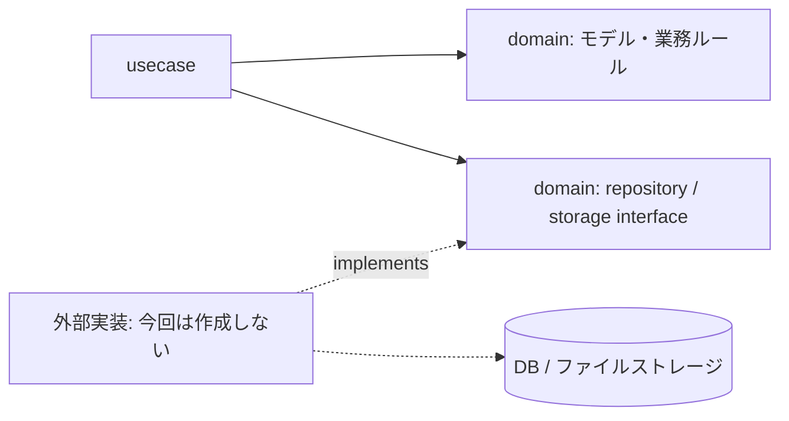
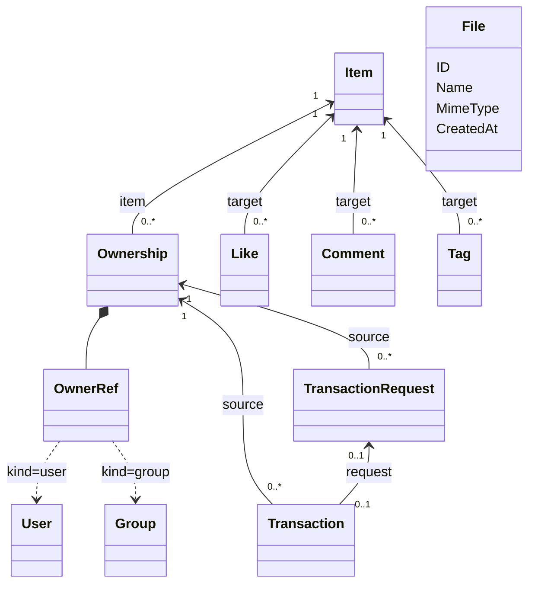

# booQ アーキテクチャモック

- Go 形式でモデルと業務フローを説明するモック。
- `domain/`：モデル・業務ルール・repository interface。
- `usecase/`：モデルを組み合わせた操作。認可は全許可。
- DB 接続・実行環境・テストは対象外。

## 依存関係

## モデルの関係

- User は別サービスが管理。ユーザーIDだけを保持し、ローカルの users テーブルは設けない。
- Ownership の PK：`(ItemID, OwnerKind, OwnerID)`。申請・貸出も同じキーで参照。
- 本・備品の分類と ISBN は持たず、備品は Group 所有として表現。
- 所有総数は Ownership、残数は「総数 − 貸出中数量」。
- File は独立したメタデータ。Item の画像は URL で保持。

## 貸し借り

- `Immediate`：直接貸出。`ApprovalRequired`：申請・承認。`Disable`：新規貸出不可。
- 申請は非予約。承認で貸出開始、返却は全量。
- 借り手は User のみ。認可を省略しても、数量・Policy・状態の制約は維持。
- 所有者変更後の履歴、Policy 変更時の既存申請は TODO。

## 資料

- [schema.sql](schema.sql)：MariaDB 向けの概念スキーマ。移行・DB 適用は行わない。
- [実装計画](docs/implementation-plan.md)・[決定事項](docs/design-decisions.md)。
- SQL の所有者参照は種類に応じて User / Group を解決。残数制約と承認・貸出の一体性は業務側の責務。
