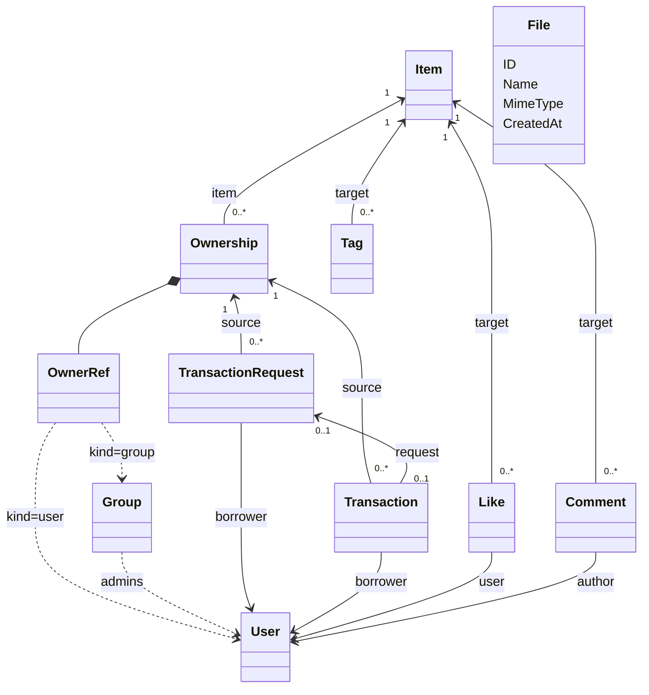

# domain・usecase の概念説明用モック実装計画

## 目的と成果物

`.tmp/domain` と `.tmp/usecase` に、モデルの責務・参照関係・業務操作の流れを説明する Go 形式のコードを作るための計画。本計画に基づく概念コードを `.tmp/domain`・`.tmp/usecase` に作成済み。

モックには構造体、列挙型、主要なメソッド、依存先の interface、処理順を示す短いコードやコメントを含める。コンパイル・実行できることは要求しない。テスト、テストダブル、DB・ストレージ・外部 API への接続、メモリ repository、起動コード、コード生成、migration は作らない。テスト・ビルド・mise の実行も、この概念説明用モックの作業には含めない。

実装対象は貸出周辺だけでなく、現行の Like・Comment・Tag・File と対応する usecase も含む。それらは現行の構成・振る舞いを基本にし、説明に不要な処理の詳細を省く。

参照文書は [元案](architecture.md)、[設計評価](architecture-review.md)、[判断事項](design-decisions.md)。以下のモデル・図は回答済みの決定事項を反映する。残る判断事項のみ TODO として区別する。

## 1. 全体の関係



この図では Transaction を成立した貸出、TransactionRequest を貸出申請として定義する（D01・D02）。承認済み申請にだけ対応する貸出が 1 件あり、自由貸出には申請がない。本・備品の分類と ISBN は持たない。File は独立したメタデータで、現行の Item.ImgUrl を FileID へ変更する前提は置かない。

Like・Comment・Tag の参照先は Item のままにする。所有者別のいいね・コメント・タグという新しい意味は導入しない。

## 2. domain に記述するモデル

| モデル | 説明する情報・責務 | 現行との差分 |
| --- | --- | --- |
| `Item` | ID、名前、説明、画像 URL、作成・更新等の日時 | 在庫・貸出条件を Ownership に分離する |
| `Ownership` | ItemID、OwnerRef、Quantity、Policy、Memo | 個人／Group 所有と所有数量を表す中心にする |
| `OwnerRef` | OwnerKind と ID | User / Group の参照を表す値として追加する。表現方法は D07 |
| `User` | traQ のユーザー識別子 | 所有者・借り手・操作ユーザーを同じ種類の識別子で参照する |
| `Group` | ID、管理者のユーザー ID 一覧 | 管理機能や traQ との同期処理は作らない |
| `LendingPolicy` | Immediate / ApprovalRequired / Disable | 貸出不可も Policy で表し、別の bool は持たない |
| `TransactionRequest` | ID、OwnershipKey、BorrowerID、数量、目的、期限、部室内利用、申請状態、返信・決定者・日時 | 申請を独立させる案。状態や記録項目は説明に必要なものを記す |
| `Transaction` | ID、OwnershipKey、BorrowerID、数量、目的、期限、部室内利用、任意の RequestID、貸出・返却状態、日時・メッセージ | 本／備品の成立した貸出を共通化する |
| `Like` | ItemID、UserID | 現行と同じ関係・粒度を維持する |
| `Comment` | ID、ItemID、UserID、Text、CreatedAt、UpdatedAt、DeletedAt | 現行と同じ情報を維持する |
| `Tag` | ItemID、Name | 現行と同じ情報を維持する。独立したタグマスタを導入しない |
| `File` | ID、Name、MimeType、CreatedAt | 現行と同じ情報を維持する |

OwnershipKey は `(ItemID, OwnerKind, OwnerID)` の複合キー。同じ Item・同じ種類と ID の Owner に Ownership は一つだけ存在する。独立した OwnershipID は置かず、TransactionRequest と Transaction は OwnershipKey を保持する。

本・備品の分類、ISBN、BookDetail、EquipmentDetail は今回削除する。現行の CountMax は Ownership.Quantity に、Count は貸出可能数の説明に役割を移す。備品は Group 所有として表す。

現行の `EquipmentTransaction` は共通 Transaction にまとめる案とする。Like・Comment 等も `.tmp` 内に記述し、既存 `internal/domain` の型をそのまま参照して省略する形にはしない。

`ItemDetail`・`OwnershipDetail`・`ItemSearchQuery` のような参照用の型も、現行を基に関係を説明する範囲で記述する。ItemDetail は Item・Tags・Likes・Ownerships をまとめる。OwnershipDetail の貸出と申請は区別して表し、ItemSearchQuery の所有者条件は OwnerRef、借り手条件は User を参照する案にする。検索アルゴリズムや SQL は不要。

### ドメインが持つルールの例

```text
所有総数 = Ownership.Quantity
貸出中数量 = 同じ Ownership の貸出中 Transaction の数量合計
貸出可能数 = 所有総数 - 貸出中数量
```

これは数量管理・申請中は非予約という決定に対応する（D03・D05）。Quantity の意味、貸出数量が正であること、許可される状態遷移など、モデル自身に属するルールを短いメソッドまたはコメントで示す。

状態遷移の説明例は次のとおり。今回は承認を貸出開始とする（D06）。

```text
TransactionRequest: pending → approved / rejected / cancelled
Transaction:        borrowed → returned
```

公開フィールドか非公開フィールドか、ID の採番、保存済みデータからの復元、エラー型の網羅性などは、このモックで詳細設計しない。モデルの意味と責務を読めることを優先する。

## 3. usecase に記述する操作

| usecase | 含める操作 | 説明する処理の流れ |
| --- | --- | --- |
| `ItemUseCase` | 単体取得・詳細取得・検索・単体／一括作成・更新・削除 | 現行の入口を維持し、物品情報と所有・貸出情報の境界を示す。認可は全許可とする（D08） |
| `OwnershipUseCase` | Item ごとの所有一覧、所有の登録・変更・削除、貸出可能数の取得 | Item と Owner の参照、数量・貸出条件の扱いを示す。削除方式は D11 |
| `LendingUseCase` | 自由貸出、申請、承認、拒否、取消、返却、申請／貸出の参照 | Ownership を貸出元として、個人・Group 所有を共通の流れで扱う |
| `LikeUseCase` | AddLike / RemoveLike / GetByItemID / IsLiked | Item 存在確認、いいねの存在確認、追加／削除。重複追加と未追加の削除をエラーにする現行の意味を維持 |
| `CommentUsecase` | CreateComment | Item 存在確認、空文字拒否、投稿者・本文を持つ Comment の作成。編集・削除など現行にない機能を追加しない |
| `TagUseCase` | GetByItemID / GetByItemIDs / ReplaceByItemID | 現行の取得範囲を維持。置換時の Item 存在確認とタグ名の重複除去を示す |
| `FileUseCase` | Upload / GetFile | サイズ・種類の確認、画像処理、実データ保存とメタデータ保存の責務、取得の流れを示す |

FileUseCase は現行の JPEG / PNG・3 MB の制限や JPEG 化の意図をコメントで残す。画像変換、UUID 生成、バイト列の読み書きは実装せず、説明上の処理名に置き換える。FileRepository はメタデータ、FileStorage はファイル本体を扱うという境界を示せばよい。

### 貸出承認の説明例

```text
ApproveRequest(actor, requestID)
  1. 申請と対象 Ownership を取得する
  2. 認可による制限は行わない（D08）。操作者は記録用の情報として扱う
  3. 申請状態・貸出可否・数量を確認する（D04、D05）
  4. 申請を承認し、対応する Transaction を作る（D02、D06）
  5. 申請の変更と貸出作成を、一つの業務操作として扱う旨を記す
```

domain は状態遷移や数量の意味を表し、usecase は取得した複数モデルと操作ユーザーを組み合わせて処理を進める。承認と貸出作成の一体性はコメントで示す。DB トランザクション、排他制御、UnitOfWork、失敗時の復元処理の実装は含めない。

## 4. 依存関係の表現

```text
usecase → domain のモデル・repository interface

FileUseCase → FileRepository / FileStorage
LendingUseCase → Ownership / Request / Transaction の repository interface
所有者の情報参照 → User / Group の参照を表す interface（必要な場合のみ）
```

現行の構成に合わせて、repository interface は domain 側にモデルと共に置く。LikeRepository・CommentRepository・TagRepository・FileRepository・FileStorage は現行の役割を維持する。所有者情報の参照は必要最小限の interface で示し、実際の取得元は決めない。

repository・storage など外部依存の interface の実装は作らない。usecase 内では interface の呼び出し例や擬似コードで依存先を表し、外側の DB・API の詳細が domain に入らないことを説明する。DI コンテナ、Clock、汎用ストア、実行用の組み立ては不要。

未決の仕様に依存する箇所には `TODO(design Dxx): ...` を添え、[判断事項](design-decisions.md) を参照する。判断に依存しない部分まで空にせず、型の関係や処理順が読める量を記述する。

## 5. 配置と作業順

```text
.tmp/
  docs/
    architecture.md          # 元案
    architecture-review.md   # 評価
    implementation-plan.md   # 本計画
    design-decisions.md      # 決定事項・残る判断事項
  domain/
    item.go                  # Item、詳細・検索用の型
    owner.go                 # OwnerRef、User、Group
    ownership.go             # 所有数量、貸出方針
    transaction_request.go
    transaction.go           # 本・備品共通の貸出
    like.go
    comment.go
    tag.go
    file.go
  usecase/
    item.go
    ownership.go
    lending.go
    like.go
    comment.go
    tag.go
    file.go
```

repository interface は関連する domain ファイルに併記する。エラーや補助型は説明に必要なものだけ追加する。既存 `internal`、go.mod、mise の設定は変更しない。

| 順序 | 作業 | 読み手が確認できること |
| --- | --- | --- |
| 1 | 決定事項と残る TODO をコードのコメントに対応付ける | 決定事項と未決の業務仕様を区別できる |
| 2 | Item・Owner・Ownership・Request・Transaction を記述する | 貸出元の統一、数量・貸出方針の所属、申請と貸出の違いが分かる |
| 3 | Like・Comment・Tag・File と必要な参照用の型を記述する | 現行の他モデルを含めた全体像と変更範囲が分かる |
| 4 | 全 usecase の入口と代表的な処理の流れを記述する | domain のルールと usecase の調整役を区別できる |
| 5 | 文書・図・コードの説明を読み合わせる | 名前・関連・仮定に食い違いがなく、全対象モデルと操作が記述されている |

## 6. 完了条件

- `.tmp/domain` と `.tmp/usecase` に、上記の全モデルと usecase の概念説明がある。
- Item・Ownership・Transaction の関連変更と、現行に近いまま維持する Like・Comment・Tag・File の位置付けが読める。
- 主要な責務・状態遷移・認可を省略する範囲を、型と短い処理例で説明できる。
- 未決事項には D 番号が付き、選択肢と影響を文書から辿れる。回答済みの事項を未決として扱っていない。
- テスト、DB 接続、実行環境を追加していない。コンパイル成功・動作確認は完了条件に含めない。

本番実装・データ移行・API 互換性・競合制御の詳細設計は、このモックを使った設計判断の後に別途行う。

## 回答に基づくフロー上の補足

- 認可は今回すべて許可する。所有者・管理者・借り手との一致確認、閲覧制限、自己承認・代理返却の禁止は実装しない。Group の管理者情報は概念として残してよいが、アクセス制限には使わない。
- Policy が Immediate なら直接貸出、ApprovalRequired なら申請・承認、Disable なら新規貸出・申請・承認を拒否する。返却は貸出後の Policy によらず扱える。この制約と数量・状態の検査は認可の省略とは別である。
- UpdateOwnership が数量・Policy・所有者等の変更を担当する。所有者の変更でキーが変わるため、履歴参照と移転先の同一キーの扱いは判断事項に残す。今回はその詳細を実装しない。
- 貸出中数量を下回る減数と、貸出中・申請中の削除は拒否する。既存申請があるときの Policy 変更の扱いは TODO とする。

## 作成したコードの読み順

1. [Ownership](../domain/ownership.go) と [Owner](../domain/owner.go)：複合キー、数量、Policy の所属。
2. [TransactionRequest](../domain/transaction_request.go) と [Transaction](../domain/transaction.go)：申請と貸出の状態遷移。各モデルにフィールドを直接記述し、承認時に引き継ぐ項目を明示する。
3. [LendingUseCase](../usecase/lending.go)：自由貸出、非予約の申請、承認・拒否・取消、全量返却。SaveApproval は承認と貸出作成を一体として説明するための interface であり、実装は持たない。
4. [OwnershipUseCase](../usecase/ownership.go)：登録、残数、減数・削除の制約。所有者変更と申請中の Policy 変更は TODO と ErrDesignPending で未決であることを示す。
5. [ItemUseCase](../usecase/item.go) と Like・Comment・Tag・File：物品情報と周辺機能。File.Upload の画像変換・保存はコメントで処理順を説明し、ErrConceptOnly を返す。

例として、Group 所有の総数 3 の物品を 2 個自由貸出すると残数は 1 になる。要承認の物品では申請時の残数は変わらず、承認時に貸出が成立して数量が減る。返却すると貸出状態が returned となり、残数の集計対象から外れる。これは読解用の説明であり、実行用シナリオやテストは追加していない。

コードは gofmt で整形し、モデル・操作・TODO の対応を読み合わせた。計画どおりテスト、ビルド、mise、DB 接続は実行していない。
